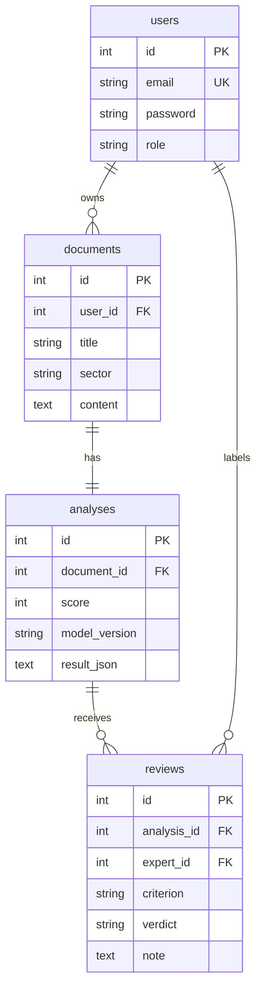

# Mimari ve API

## Kararlar

PHP 8.0 XAMPP ortamıyla doğrudan uyumludur. Framework gerektirmeyen küçük katmanlar sayesinde kurulum dış paket yöneticisine bağlı değildir. PDO parametreli sorgularla SQLite ve MySQL arasında bağlantı seçimi sağlar. SQLite yerel geliştirme içindir; üretimde MySQL hedeflenir.

`index.php` isteği → oturum ve CSRF denetimi → uygulama fonksiyonları → PDO → HTML şablonları. `api.php` aynı doğrulama ve analiz fonksiyonlarını kullanır. API anahtarı veya harici model çağrısı yoktur. Veritabanı kurulum işlemi web isteklerinde otomatik çalıştırılmaz.

## Veri modeli

`reviews` tablosunda analiz + uzman + kriter üçlüsü benzersizdir. Başka bir uzmanın etiketi değiştirilmez. Belge silinince analizi ve etiketleri yabancı anahtarla silinir. Otomatik analiz sonuçları uzman etiketleriyle üzerine yazılmaz; araştırma karşılaştırmaları için ayrı kalır. `login_attempts` tablosu e-posta bazlı 15 dakikalık giriş sınırı tutar.

## Ekran ve yetki

| Ekran | Kullanıcı | Uzman | Yönetici |
|---|---|---|---|
| Giriş/kayıt | Açık | Açık | Açık |
| Genel bakış/yeni analiz | Kendi kayıtları | Kendi kayıtları | Kendi kayıtları |
| Rapor | Kendi belgesi | Tüm belgeler | Tüm belgeler |
| Geçmiş/karşılaştırma | Kendi belgeleri | Kendi belgeleri | Kendi belgeleri |
| Uzman incelemesi | Kapalı | Tüm analizlere etiket | Etiket ve rol yönetimi |

## JSON API

Kalıcı analiz uçları giriş yapılmış oturum gerektirir; kimliği doğrulanmamış istek 401 döndürür. `GET api.php?guest=1` yalnızca mevcut oturumun misafir raporunu sunar, yoksa 404 döndürür. `download=1` bu raporu dosya olarak indirir. Bu uç yeni analiz oluşturmaz ve kota denetimini aşamaz. POST için HTML formundaki oturuma bağlı `csrf` değeri `X-CSRF-Token` başlığında iletilir.

| Metot | Yol | Girdi | Çıktı | Durum |
|---|---|---|---|---|
| GET | `api.php` | Yok | Kullanıcının son 100 analizinin özeti | 200, 401 |
| GET | `api.php?id=ID` | Analiz kimliği | Sonuç ve uzman değerlendirmeleri | 200, 401, 404 |
| GET | `api.php?id=ID&download=1` | Analiz kimliği | JSON dosyası | 200, 401, 404 |
| POST | `api.php` | JSON: title, sector, content | id, report_url | 201, 400, 401, 403, 413, 422 |

Standart kullanıcıya ait olmayan rapor, varlığını açıklamamak için 404 verir. Desteklenmeyen metot 405 ve `Allow: GET, POST` döndürür. Şema sürümü raporda tutulur. API güvenli yerel kullanım için oturum tabanlıdır; servisler arası kimlik doğrulama uygulanmadı.

## Analiz yöntemi

Skor ağırlıkları: kimlik 18, amaç 18, aktarım 18, toplama yöntemi 13, hukuki sebep 15, haklar 18. Toplam 100. Her kriterde ilk örüntü grubu zorunlu bir konu işaretidir; bu işaret bulunmadığında diğer genel sözcükler puan üretmez. Konu işareti bulunduğunda eşleşen örüntü grubu oranı ağırlıkla çarpılır. Kısmi eşleşmeler orantılı puanlanır. Başvuru ve saklama kontrollerinin ağırlığı sıfırdır; tamamlayıcı bilgi olarak gösterilir.

Anahtar kelimelerin bulunması amaç–hukuki sebep ilişkisini, metnin doğruluğunu veya mevzuata uygunluğunu ispatlamaz. Cümle kanıtları değerlendirmeye yardımcı olur; yanlış olumlu/olumsuz sonuçlar mümkündür. Olumsuz cümleler ve karmaşık sözdizimi bu ilk motorun bilinen sınırıdır. Uzman etiketleri sonraki baseline–BERT deneyleri için veri temeli sağlar, ancak etiketlenmiş veri seti ve model başarıları henüz mevcut değildir.

## Güvenlik

- XSS: Tüm değişken HTML çıktıları `htmlspecialchars` ile kaçışlanır; kullanıcı HTML'i çalıştırılmaz.
- SQLi: Veri değerleri PDO parametreli sorgularla bağlanır.
- CSRF: Durum değiştiren formlar ve API POST oturum belirtecini doğrular.
- Kimlik: `password_hash` / `password_verify`, girişte oturum kimliği yenileme, HttpOnly ve SameSite=Lax çerez, HTTPS varsa Secure; iki saat hareketsizlikte oturum sıfırlama.
- Yetki: Kullanıcı rolü her istekte veritabanından okunur; rapor ve değişiklik işlemlerinde sahiplik kontrolü yapılır. Yeni hesap kendi rolünü seçemez.
- Korumalı dosyalar: Apache `.htaccess`; PHP geliştirme sunucusunda yalnızca açık dosyaları sunan router.
- Giriş sınırlama: Aynı e-postaya beş hatalı girişten sonra 15 dakika bekleme. İnternet yayını öncesi IP tabanlı sınırlama da eklenmelidir.
- Kişisel veri: Dış model servisine aktarım yok. Uzman erişimi gönderim alanında bildirilir. Geliştirme örnekleri kurgusaldır.

## Kaynak inceleme notları

Ana yol haritası ve kaynak altındaki iki PDF ile ders yönergesinin metni incelendi. `Değerlendirme.txt` boş dosyadır. Madde 10'da PHP listelenmiyor; kullanıcı tercihiyle seçildi. SQLite yönergede yalnızca geliştirme için izinli. Teknoloji onayı, yayın ve akademik teslimler tamamlanmış kabul edilmez.

TÜBİTAK dosyası araştırma sorusu, ölçülebilir hedefler, yöntem, en fazla 12 ay takvim ve toplam 100 ağırlıklı başarı ölçütleri istiyor. Bu uygulama o araştırmanın web/veri altyapısını başlatır. Bu oturumda başvuru raporu, bilimsel literatür taraması, model eğitimi veya deney sonuçları üretilmedi.

## Sürüm 1.1 değişiklikleri

- `guest_trials`: `token_hash` birincil anahtarı ve `used_at` alanı. Aynı tarayıcı belirtecinin ikinci tüketimi veritabanı benzersizliğiyle engellenir. İstekler arasındaki kontrol yalnızca arayüze bırakılmaz.
- Misafir metni ve sonuç yalnızca PHP oturumunda tutulur; kota tablosunda metin veya IP tutulmaz. Oturum dosyası sunucu tarafında geçici saklamadır; mutlak bellekte işleme iddiası yoktur.
- Ana analiz ve misafirin kendi rapor ekranı herkese açık. Geçmiş, kalıcı API, uzman değerlendirmesi ve rol yönetimi önceki yetkileri korur.
- Girişte ikinci analiz taslağı korunur; misafir raporunu kaydetmek açık bir form işlemidir. Giriş kendi başına raporu uzmanlara açmaz.
- Cümle bağlamlı motor, ayrı cümlelerdeki ilgisiz kelimeleri toplayarak puan oluşturmaz. Açık bir devam zamiri bulunan sonraki cümle bağlama alınabilir.
- Eksikliği bildiren olumsuz ifadeler olumlu kanıt sayılmaz; açık aktarım-yok beyanı ayrı açıklamayla değerlendirilir. Genel amaç, somut olmayan hukuki dayanak ve belirsiz saklama süresi daha düşük bulgu üretir.
- Platform/form ve başvuru/AŞ gibi alt sözcük hataları için regresyon testleri eklendi. Kısaltmalar cümle ayrımında korunur.
- Belirsiz kapsam, uzun cümle ve aydınlatma/rıza karışımı için ayrı inceleme uyarıları üretilir. Kural tabanlı yöntem hâlâ anlamsal doğruluk garantisi vermez; model başarımı/F1 ölçülmedi.
- Eski raporlar yeniden yazılmaz; kendi motor sürümüyle saklanır. Yeni motorla karşılaştırma gerekiyorsa metin yeniden analiz edilmelidir.
- Manrope fontu ve lisansı yerel dosyada. Giriş/kayıt sayfası 100dvh düzene sahip; dar ve kısa ekranlarda yardımcı içerik azaltılır. Olağan dışı erişilebilirlik/zoom durumlarında form içinde taşma erişilebilir kalır.
